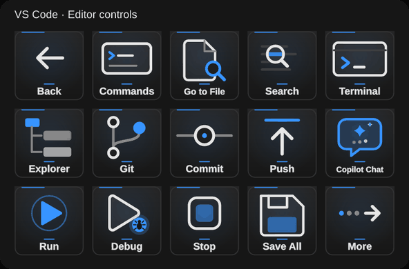

# VS Code Controls

Windows Stream Deck companion, version 2.4.0.0. Includes 27 editor actions, configurable shortcuts and commands, project launching, automatic focus switching and Back.

Install Windows Daily Toolkit 2.6+ to coordinate direct switching with other app companions. Existing action IDs and the editable VS Code profile are preserved. The default App theme follows the editor's charcoal panels, blue accent and status-bar motion. Pro, Colourful and Vivid looks, 29 colours and six-second/12 fps animation are available on every key.

## Build



```sh
npm ci
npm run build
npx tsc --noEmit
npm test
npm run validate
npm run pack
```

Install `dist/com.dailyops.vscode.v2.streamDeckPlugin` and accept the editable VS Code profile. Select VS Code with Toolkit Open App, or focus the editor. Back returns to the main keys.

MIT license. Unofficial plugin; not affiliated with Microsoft.
