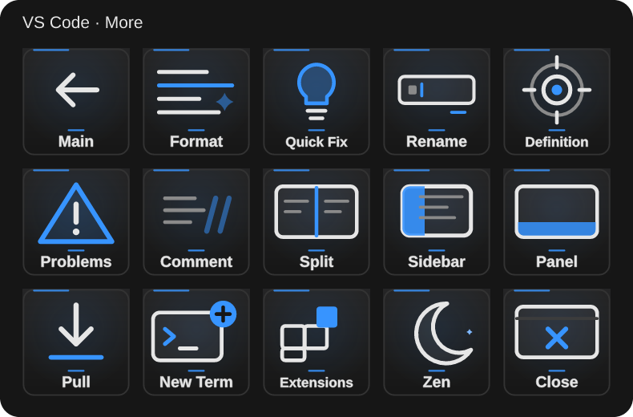
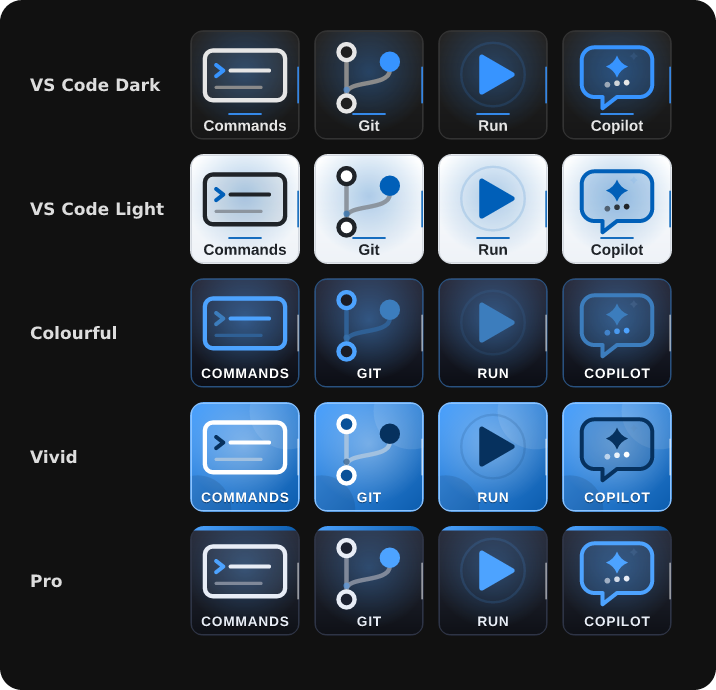

# VS Code Controls

Unofficial Elgato Stream Deck plugin for **Visual Studio Code on Windows** (also Code Insiders and VSCodium). Version 2.5.1.0.

33 animated keys for commands, files, search, terminal, Git, run/debug, Copilot Chat and editing, plus Open Project, Custom Shortcut and Custom Command. The keys appear automatically when VS Code is in front (with Windows Daily Toolkit), and **Back** returns to your main keys.


## Install in three steps

1. Download **VSCodeControls-Installer-2.5.1.0.zip** from [Releases](https://github.com/nikhilgs817/streamdeck_vscode/releases/latest).
2. Right-click the ZIP, choose **Extract All**, and open the extracted folder.
3. Double-click **Install-VSCodeControls.cmd**. Wait for the success message; Stream Deck restarts automatically.

No Git, Node.js or build commands are needed. Windows Daily Toolkit is included for automatic app switching. The installer verifies files, backs up your setup, keeps your layouts and settings, and rolls back a failed update. [Full installation, update and recovery guide](docs/INSTALL.md).

## The keys

**Page 1 (VS Code):** Back · Commands · Go to File · Search · Terminal / Explorer · Git · Commit · Push · Copilot Chat / Run · Debug · Stop · Save All · More

**Page 2 (More):** Main · Format · Quick Fix · Rename · Definition / Problems · Comment · Split · Sidebar · Panel / Pull · New Term · Extensions · Zen · Close



Also in the action list: Open Project…, Custom Shortcut… and Custom Command….

| Key | Sends |
|---|---|
| Commands, Go to File, Search | Ctrl+Shift+P, Ctrl+P, Ctrl+Shift+F |
| Terminal, New Term | View: Toggle Terminal, Terminal: Create New Terminal |
| Explorer, Git | Ctrl+Shift+E, Ctrl+Shift+G |
| Commit, Push, Pull | Git: Commit, Git: Push, Git: Pull (Command Palette) |
| Copilot Chat, Quick Fix, Panel, Extensions | Ctrl+Alt+I, Ctrl+., Ctrl+J, Ctrl+Shift+X |
| Run, Debug, Stop | Ctrl+F5, F5, Shift+F5 |
| Format, Save All | Shift+Alt+F, File: Save All |
| Sidebar, Split, Comment | Ctrl+B, Ctrl+\\, Ctrl+/ |
| Definition, Rename, Problems | F12, F2, Ctrl+Shift+M |
| Zen, Close | View: Toggle Zen Mode, Ctrl+W |
| Open Project… | Opens a folder (tap / double-tap / hold = monitor 1 / 2 / 3) and shows these keys |
| Custom Shortcut… / Custom Command… | Any shortcut (e.g. `Ctrl+K Ctrl+S`) / any palette command (e.g. `Git: Sync`) |

Every key first brings VS Code to the front and **sends nothing if VS Code is not in front**; it also stops if focus moves away during a multi-step command. VS Code must be running (Open Project starts it).

## Appearance



| Style | Look |
|---|---|
| **VS Code Dark** (default) | Charcoal panels, VS Code blue accents, bold Segoe UI labels |
| **VS Code Light** | Light editor panels with the same icons |
| **Colourful** | Coloured icons on dark glass |
| **Vivid** | White icons on a bright gradient |
| **Pro** | Restrained slate keys with a thin accent strip |

Every icon has its own animation (the commit dot pulses, push/pull arrows lift, the breakpoint badge pulses, the terminal cursor blinks, the split line slides) in a six-second loop at 12 fps. The icon moves gently and an accent light travels round the key; labels stay still. Turn **Gentle loop** off for a still key. You can pick another icon, change the label or use your own picture.

## Build and verify

```sh
npm ci
npm run build
npx tsc --noEmit
npm test
npm run validate
npm run pack
npm run build:installer
npm run test:installer   # Windows only
```

## Known limits

- Shortcuts are VS Code's defaults. If you changed a keybinding, use Custom Shortcut or Custom Command.
- Copilot Chat needs the GitHub Copilot Chat extension.
- Managed PCs that run PowerShell in Constrained Language Mode can stop the keys.

MIT license. Unofficial plugin; not affiliated with or endorsed by Microsoft. Visual Studio Code is a trademark of Microsoft Corporation. The icons are original artwork.
